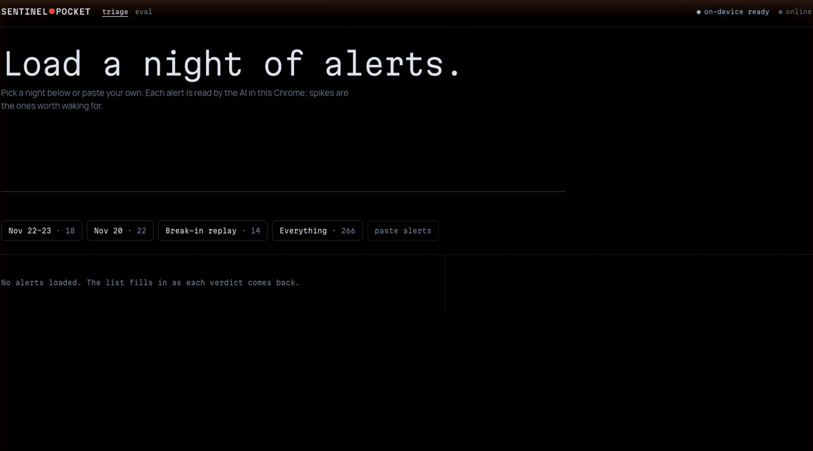

<div align="center">

# Sentinel Pocket

**The AI in your own Chrome sorts server security alerts into noise, check or danger. Your logs stay on your machine.**

[](LICENSE)


My entry for #BuildHybridAI 2026. **[▶ Watch the 3-minute demo](https://youtu.be/bxhhcbc0pzo)** · [Try it live](https://sentinel-pocket.web.app)

</div>

## Why I built this

I run a small production server with a watchdog on it. In ten days it raised over
fifteen hundred security alerts. Almost all of them were nothing: backups, app
installs, my own admin work. But I still had to read each one, because one of them
could be a real break-in.

I wanted something to read them for me. I did not want to paste my logs into a
cloud chat: they hold IPs, commands, user names and secret paths. So Sentinel Pocket
judges every alert with Gemini Nano, the model built into Chrome, on my own machine.
It is fast, free, and works offline.

When I want a deeper look, I press "Investigate deeper": a scrubbed copy (IPs, names
and paths replaced) that I see before I send it goes to the cloud. On a browser with
no Nano, the hybrid model may send at most 3 scrubbed alerts a day to the cloud by
itself; past that, only when I click. Every answer on screen says where it ran: on
this device or in the cloud.

## A quick look



1. Load a sample night (or paste your own alerts).
2. Each alert gets a verdict: noise, check or danger, with one plain reason and a next step.
3. The headline tells you how many need you, and how many you can sleep through.
4. Open a danger alert, press "Investigate deeper", check the scrubbed preview, then send it to the cloud.
5. The `/eval` page runs the whole labelled set and shows the score.

## How it decides

Each alert goes through two passes on the device, with a guardrail written in code.

1. **Pass 1:** Gemini Nano judges the alert on its own, without any notes about my server.
2. **Hard signs:** code checks the alert for 11 general intruder signs, for example a new SSH login key for root, a new account with uid 0, sudo for ALL commands, a known miner, a program run from a temp folder by a service account, or a privileged container. A hard sign always makes the verdict "danger". Nothing can excuse it.
3. **Pass 2:** only if pass 1 said "danger" or "check" and no hard sign fired. Nano now reads my house notes (what is normal on this server) and may lower the verdict to "noise", and to nothing else.

Why two passes: when I gave Nano the house notes in a single pass, it let the notes
excuse real intruder signs. Without the notes it raised dozens of false alarms.
Splitting the two jobs fixed both. The rules live in `src/lib/triage.ts`
(`hardSigns`, `mergeVerdicts`); the home screen uses them through
`src/hooks/use-triage.ts`, and so does the eval page.

**Hybrid triage with a cloud budget, and the rules are the floor.** Each alert goes to the hybrid model (`InferenceMode.PREFER_ON_DEVICE`): Gemini Nano when Chrome has it, the cloud model when it does not. The cloud part has a budget: at most **3 cloud answers per browser per day** (counted in localStorage under today's date). After 3, the rest of the night runs on an on-device-only model plus the rules. Cloud-bound triage text is scrubbed first (IPs, names, apps and secret paths replaced, the same scrubber as "Investigate deeper"). One on-device probe (`ONLY_ON_DEVICE`, so it never spends cloud quota) runs before the first night, and it waits up to 30 s because Nano can take that long to load after a Chrome restart (the status strip says it is warming up). If Nano says "available" but stays silent, the hybrid model is not asked at all (it would wait on the device too): the code rules take over. A hard sign alone marks the alert danger ("flagged by rule"), and anything else is shown as "not sorted". Nano is asked again in the background every 20 s (3 tries). If it answers, the alerts still not sorted are sorted on-device. More cloud only when I click. "Investigate deeper" is `ONLY_IN_CLOUD`, sent after I see the scrubbed preview. A button appears when there are unsorted alerts and on-device is not answering: "Ask the cloud to sort the N unsorted alerts". It sends at most 5 alerts per click, one at a time, and the button warns that it uses the shared free quota. If the cloud answers 429 with a long wait (the daily quota), all cloud use stops for the session at once, and the app says the quota is used up for today and when it resets (`src/lib/hybrid.ts`, `src/hooks/use-triage.ts`). The eval page still measures Nano alone.

## Results

I labelled 266 alerts in `data/alerts.json`: 252 real alerts from my server
(scrubbed before they entered this repo) and 14 replays of a real break-in pattern.
245 are noise, 21 are danger.

Measured on a Mac (Apple M1 Max, Chrome 158, Gemini Nano on-device), 2026-11-23.
Every alert was answered on the device. I split the alerts by id: even ids were for
tuning, odd ids were held out and scored only in the final run.

| Measure | All 266 | Tuning half (even) | Held-out half (odd) |
|---|---|---|---|
| Exact (verdict equals label) | 99.2% | 100.0% | 98.5% |
| Danger alerts caught | 19/21 | 11/11 | 8/10 |
| False alarms (noise called danger) | 0 | 0 | 0 |
| Noise left as "check" | 0 | 0 | 0 |
| Timeouts | 0 | 0 | 0 |

- Time: about 2.5 s per alert on average, both passes together (2,525 ms; pass 1 alone about 2.0 s). Pass 2 runs only on alerts pass 1 flags: 64 of 266 here.
- Before two passes: one pass without house notes caught 20/21 dangers but raised 45 false alarms (76.3% exact). One pass with house notes had 0 false alarms but caught only 10/21 (95.1% exact).

Every round, the method and the misses: `docs/EVAL.md`.

## Limits

- **It missed 2 dangers**, both in the held-out half. Both are signs my prompt names but my hard-sign code does not cover yet: a web app service account running a script from a hidden file in a temp folder, and a web app service account reading many secret settings files. Pass 1 called both danger; pass 2 lowered them because a house note about web app installs looked similar. Written up in `docs/EVAL.md`.
- **Pass 2 is weak on its own.** It said "noise" on all 64 alerts it saw. The hard signs are what stop real danger from being excused.
- **The labelled set is small:** 266 alerts, only 21 of them danger, from one server.
- **The held-out half is not fully independent.** Many alerts come in near-identical pairs, and I read the first miss list across both halves to find the failure kinds. Fresh alerts are the real test.
- **Windows:** while I was building it, Gemini Nano in Chrome on Windows once hung for more than 4 minutes on one alert. Every model call now has a 20 s limit, and a timeout is counted as its own result, never dropped. The numbers above are from the Mac. On a Chrome whose Nano says "available" but never answers, the home screen waits 30 s once, then sorts by the rules with no per-alert waits and no cloud calls (Break-in replay, headless with a silent Nano stub: 30 s, 12 flagged by rule, 2 not sorted, 0 cloud requests).
- **Cloud quota:** the cloud side runs on the Firebase AI Logic free tier for `gemini-3.6-flash`. That is about **20 requests a day for the whole project**, shared by every visitor of the hosted site. An earlier version sent alerts to the cloud automatically when Nano hung, and one 18-alert night used up the day's quota. So the automatic part now has a budget: the hybrid model may get at most 3 cloud answers per browser per day, and any more cloud is on a click ("Investigate deeper", or "Ask the cloud to sort", at most 5 alerts per click). The budget is per browser, so many visitors on the hosted site can still use up the shared quota together. When the quota is gone, the app stops all cloud calls for the session and says "the cloud quota is used up for today" and when it resets. On-device sorting and the rules keep working.

## Run it

You need Node, pnpm, and Chrome with the built-in AI (Gemini Nano) turned on.

```
pnpm install
cp .env.example .env.local   # fill in your own Firebase web app values
pnpm dev
```

Variables (see `.env.example`): `NEXT_PUBLIC_FIREBASE_API_KEY`, `NEXT_PUBLIC_FIREBASE_AUTH_DOMAIN`, `NEXT_PUBLIC_FIREBASE_PROJECT_ID`, `NEXT_PUBLIC_FIREBASE_STORAGE_BUCKET`, `NEXT_PUBLIC_FIREBASE_MESSAGING_SENDER_ID`, `NEXT_PUBLIC_FIREBASE_APP_ID`, `NEXT_PUBLIC_RECAPTCHA_SITE_KEY`.

Pages: `/` (triage), `/eval` (whole-set run), `/smoke` (one alert through each route).

Hosting notes: `docs/HOSTING.md`. Demo video script: `docs/VIDEO.md`.

## Built with

All the Firebase code is in `src/lib/firebase.ts` and `src/lib/triage.ts`.

- **Firebase AI Logic, hybrid:** `getGenerativeModel` with `InferenceMode.PREFER_ON_DEVICE` for triage. On the device, Nano must return valid JSON (`promptOptions.responseConstraint` set to `VERDICT_SCHEMA`: verdict, reason, next_step); in the cloud, `gemini-3.6-flash` gets the same system prompt and `responseSchema`. `response.inferenceSource` says where each answer ran, which drives the badge and the cloud budget (3 per browser per day).
- **Firebase AI Logic, on-device only:** the same triage with `InferenceMode.ONLY_ON_DEVICE`, for the warm-up probe and for the rest of a night once the cloud budget is spent. It never reaches the cloud.
- **Firebase AI Logic, cloud only:** `InferenceMode.ONLY_IN_CLOUD`, in two models. The first is "Investigate deeper", called only after I have seen the scrubbed preview. The second is the same triage contract in the cloud, called only when I press "Ask the cloud to sort".
- **Firebase App Check** with `ReCaptchaEnterpriseProvider`, so only this app can call the models.
- **Gemini Nano** through Chrome's built-in AI.
- **Next.js** and **Tailwind CSS** for the app.

One system prompt and one answer shape serve both routes, so on-device and cloud answers can be compared fairly.

---

<div align="center">

Apache-2.0. See `LICENSE`. Copyright 2026 Joy Ahmed.

</div>
